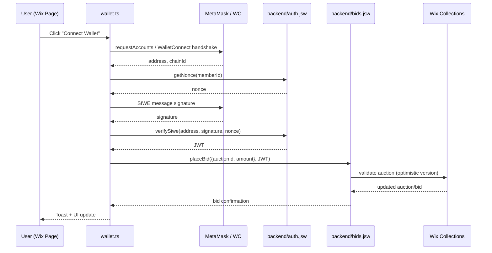

## Wix Wallet Flow Redesign

We are removing the Auctions iframe dependency because it blocks first‑party cookies, causes MetaMask popups to fail, and makes `/ _functions` auth impossible to secure. Phase 1 moves all wallet UX directly into the Velo page so Wix owns the window context and can run SIWE without cross‑origin messages.

### Event Flow

### Phase 1 Scope

- EVM wallets: MetaMask + WalletConnect v2 (covers Binance Wallet).
- Single chain id (config via secret `SUPPORTED_CHAIN_ID`).
- SIWE login, JWT stored in wix-storage session.
- Collections: `MembersWallets`, `Auctions` (add `version`), `Bids`, `AuthNonces`.
- Actions supported: connect wallet, sign SIWE, place bid, create/update auction, list bids.

### Phase 2 Backlog

- Additional chains (Solana/Phantom) with chain-agnostic signatures.
- Automatic escrow settlement + on-chain proofs.
- Scale beyond Wix collection limits with external DB + HTTP functions proxy.
- Push notifications / WebSocket live bids.
